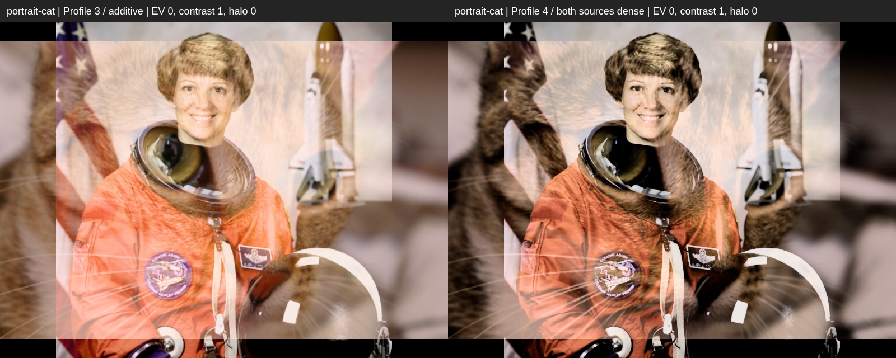

# Плотные тени: profile 3 ↔ profile 4

Кандидат 4, не опубликован и не default. Runtime `85cb495`, начало продолжения
`0d5250c`. Интерфейс/controls/старые профили неизменны; main default=2.

Profile 4 подавляет слабый свет в каждом исходнике до сложения. В 3 два
тёмно-серых source 64/255 дают 83/255; в 4 — 5/255. Это не прозрачность
слоя и не изменение прежнего user Contrast. Часть теневых деталей теряется.

## Прямое сравнение

Слева profile 3, справа profile 4. Одинаковые источники/геометрия/seed=51,
EV=0, balance=0, Contrast=1, halo=0. Halo выключен для изоляции основного
смешения; его работа отдельно проверена render harness.

| Пара | Сравнение 3↔4 | Шесть вариантов + исходники |
| --- | --- | --- |
| Портрет / кошка | [Открыть](portrait-cat-3-vs-4.jpg) | [Исследование](portrait-cat-study.jpg) |
| Кофе / кошка | [Открыть](coffee-cat-3-vs-4.jpg) | [Исследование](coffee-cat-study.jpg) |
| Ракета / портрет | [Открыть](rocket-portrait-3-vs-4.jpg) | [Исследование](rocket-portrait-study.jpg) |
| Ветки / фактура | [Открыть](branches-3-vs-4.jpg) | [Исследование](branches-study.jpg) |



В шестисторонней таблице:

1. Верхний ряд: source A/B и параметры.
2. Средний ряд: profile 3 / profile 4 / подготовлен только A.
3. Нижний ряд: подготовлен только B / плавный выбор более тёмного /
   profile 3 с user Contrast=1.5.

Три односторонних/масочных варианта — тестовые shader prototypes, не добавленные
в приложение профили/controls. Масочный вариант скрывает части лиц и создаёт
контуры переключения; в 4 сохраняется световое сложение.

На rocket/portrait profile 4 даёт 28.12% почти чёрного в центральной области
против .04% у 3. Это показывает силу эффекта, **не** доказывает лучший результат:
такой вариант может слишком затемнять небо, волосы и фактуру.

## Profile 2, halo и JPEG

- [Поля: неизменный profile 2 и новый 4](profile2-vs-4-patches.jpg)
- [Гало: profile 2 и 4](profile2-vs-4-halo.jpg)
- [Tiled JPEG profile 4, 1500×2000](candidate-tiled.jpg)

Остальные семь source/profile2/profile4 таблиц воспроизводятся локально первым
harness ниже, в `lab-out/lighttable/dense/`. Сохранённый предыдущий research
snapshot profile 3 находится в [film-comparisons](../film-comparisons/README.md).

## Воспроизведение и численные данные

```sh
LIGHTTABLE_TEST_PROFILE=4 node scripts/lighttable-film-check.mjs
node scripts/lighttable-density-check.mjs
# Regression прежнего profile 3:
node scripts/lighttable-film-check.mjs
```

[Render evidence / snapshots](render-evidence.json) •
[Шесть вариантов / измерения](study-evidence.json) •
[Checks / 62 защищённых файла](checks.json) •
[Формулы, первичные источники, ограничения](../IMAGE_ALGORITHM.md)

Frozen shader 3 точно соответствует `0d5250c`; текущий 3 совпадает с ним
пиксель в пиксель в семи comparisons. Frozen 2 также остаётся идентичным.
Измерения `nearBlackFraction`: display-luma<=16/255, `darkFraction`: <=48/255,
общая центральная область x=[100,700), y=[70,530) в 800×600 render. Пустые
поля/подписи не входят в эту область. Это измерения распределения, не оценки
качества и не линейные luminance единицы.

Источники/лицензии прежние: [NASA/CC0/SpaceX и SHA](../../../scripts/fixtures/film-photos/README.md).
Пользовательские фото не опубликованы. Результаты Chromium SwiftShader;
Safari/iPhone/HEIC/HDR/P3/плавность не проверены.
